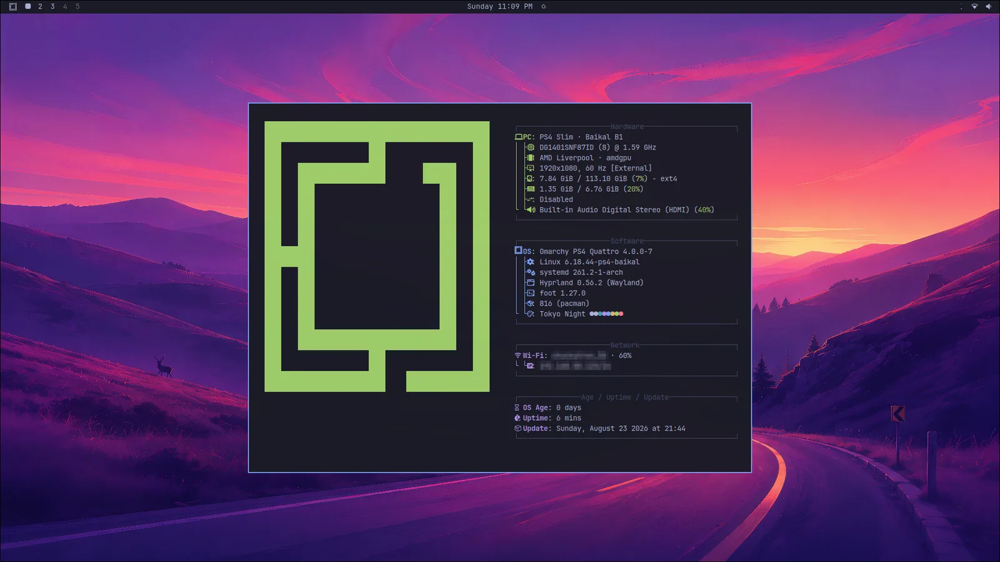
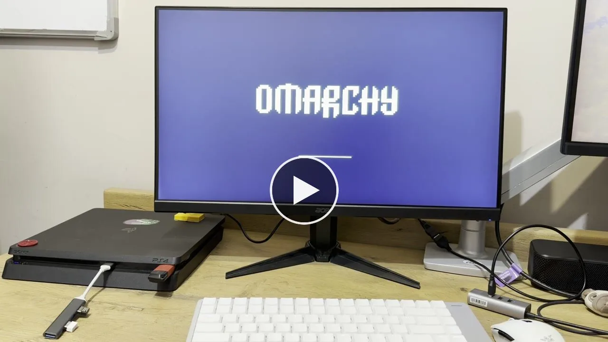

# Welcome to Omarchy psX!

Omarchy psX brings the Omarchy desktop to PlayStation: Arch Linux, Hyprland, the Quickshell bar, and Omarchy's themes and applications, running from an external USB drive. The companion [Linux psX](https://github.com/meerzulee/linux-psx) project provides the console kernel patches and builds.

Under the hood, a PS4 is an eight-core AMD x86-64 computer with a Radeon-family GPU. That's a perfectly good Linux machine hiding under a lot of TVs, and it deserves a beautiful desktop. Also, it's just fun.

_A recorded Omarchy desktop on the project's PS4 Slim. This demonstration shows an earlier boot set; it does not qualify a newly built kernel or image._

## Where we are

Omarchy psX is a **hardware-development beta**. Recorded hardware observations come from one PS4 Slim with a Baikal B1 southbridge. The desktop, Wi-Fi, USB input, and short accelerated OpenGL and Vulkan tests have worked on specific boot sets. Other PS4 models are untested, and a complete PS5 desktop is still planned. [What Works](09-what-works.md) explains the evidence and remaining limits.

## How the pieces fit

- [Upstream Omarchy](https://github.com/omacom/omarchy) is the desktop. We pin Omarchy 4.0.0 (Quattro) and change as little as possible.
- [Linux psX](https://github.com/meerzulee/linux-psx) is the kernel: the console patches, configurations and builds that make Linux run on the hardware.
- Omarchy psX is everything in between: PS4-safe settings, the first-boot owner setup, the launcher that starts Linux, the USB layout, recovery and these docs.

## Where this guide begins

Start with [Getting Started](02-getting-started.md) for USB preparation. Downloads and release announcements are posted in the [Omarchy psX Telegram channel](https://t.me/omarchy_psx); check each post for its hardware and development status.

Start with an established Linux boot environment on your console. This guide covers the Linux system from that point: choosing matching components, preparing external storage, using the desktop, and recovering from a failed candidate.

The Linux root filesystem lives on the USB drive. Normal boot profiles disable Linux access to the internal SATA disk; the launcher maintains its own boot files under `/data/linux/boot`. [Storage](07-storage.md) describes those boundaries.

Omarchy psX is an independent community port. See the [legal notice](15-legal-notice.md) for licenses and attribution.

<!-- manual-navigation -->

---

[Contents](README.md) · [Next →](02-getting-started.md)
